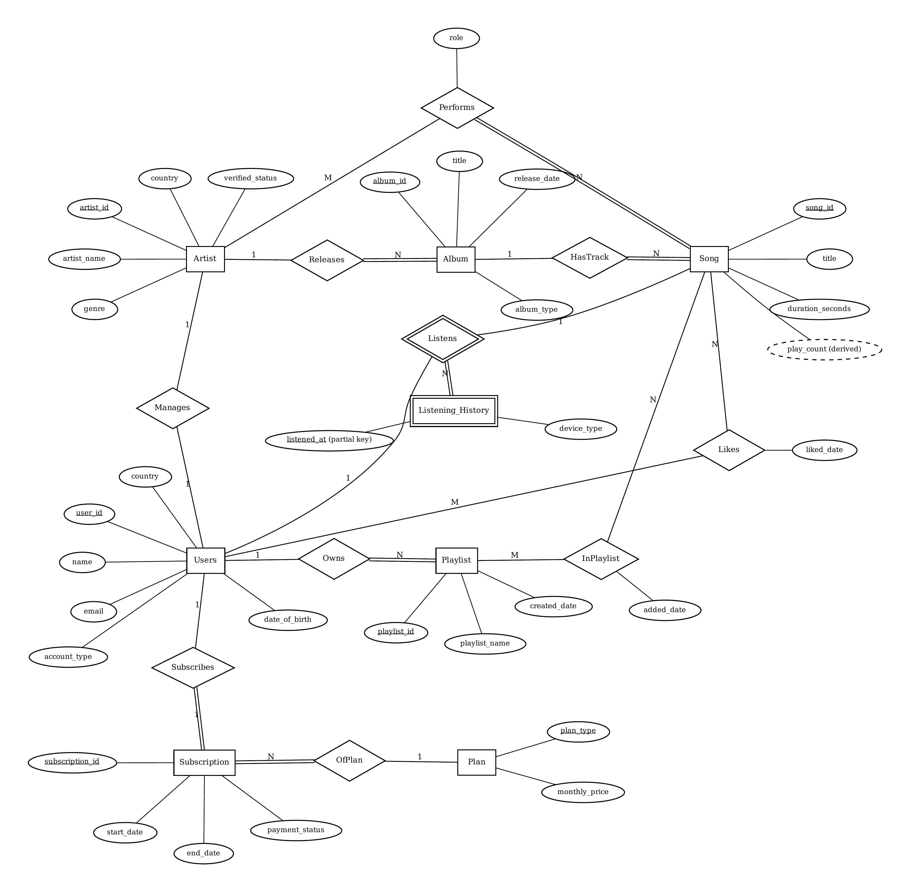
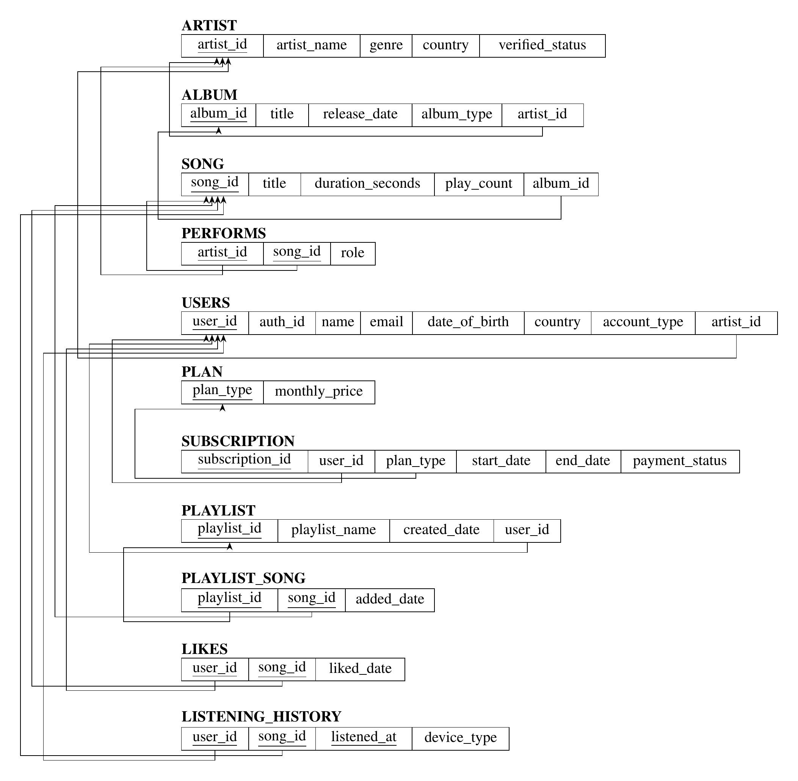

# Music Streaming Platform

**CS F212 Database Systems: Course Project, First Semester 2026-27**
BITS Pilani, Hyderabad Campus

A database-backed music streaming platform. The database stores a music catalogue (artists, albums, songs and per-track performer credits) together with user activity: playlists, liked songs, listening history and subscriptions. Business rules are enforced inside PostgreSQL through keys, CHECK constraints, triggers and transactional stored functions. The same data powers reports such as top songs by country, artist monthly listeners and a personal yearly "Wrapped" summary.

There are three kinds of users. Listeners search, play, like and organise music. Artists manage their own catalogue. Admins maintain users and the catalogue and see platform-wide reports.

## Team

| Name | ID |
|---|---|
| Ritwik Sethi | 2023B1A71385H |
| Arihant Rakhecha | 2023B1A70998H |
| Shreyas Ghosh | 2024A1PS0826H |
| Shreya Agrawal | 2023B5A30794H |
| Piyush Gaikwad | 2024A1PS0859H |

## Tech stack

| Layer | Technology |
|---|---|
| Frontend | React 19, Vite 7, JavaScript (JSX), React Router 7, Tailwind CSS 4, Recharts, lucide-react |
| Data access | supabase-js, wrapped in `src/services/api.js` |
| Backend | Supabase: Auth, PostgREST API, Row Level Security, PL/pgSQL functions called via `supabase.rpc()`, SQL views |
| Database | PostgreSQL (hosted on Supabase) |

Architecture: **React front end ↔ Supabase (Auth, API, RLS, stored functions) ↔ PostgreSQL**. Simple reads go through the API on tables and views. Every write that touches more than one table or enforces a business rule runs as a stored function in a single transaction. All reports are computed in SQL.

## Database design

The full design document (requirements, ER model, relational schema, constraints, normalization and design decisions) is in [`docs/DBMS_Midsem_Submission v3.pdf`](<docs/DBMS_Midsem_Submission v3.pdf>).

### ER diagram



### Relational schema

Primary keys are underlined; arrows go from each foreign key to the key it references.



The schema has 11 relations: `artist`, `album`, `song`, `performs`, `users`, `plan`, `subscription`, `playlist`, `playlist_song`, `likes` and `listening_history`. All of them are in BCNF. `listening_history` is a weak entity identified by (`user_id`, `song_id`, `listened_at`). `song.play_count` is the one deliberately stored derived value, and a trigger keeps it consistent.

## Planned workflows

1. **Album release (artist).** A stored function inserts the album, its songs and the performer credits in one transaction, and rolls the whole release back if any track is invalid.
2. **Listening and charts (listener).** Each play is recorded and validated by triggers, which also update play counts. The Charts and Wrapped pages read SQL views built with CTEs, window functions and aggregation.
3. **Playlists and subscription (listener).** Duplicate songs, the free-tier playlist limit and cascading deletes are all enforced by the database, and the front end shows the resulting errors.

## Current progress (mid-semester)

The ER model, the relational schema and the technology stack and application architecture are complete. The implementation now matches the design doc end to end:

- **Schema** (`sql/01_schema.sql`): all 11 relations, exactly as designed.
- **Triggers and transactions** (`sql/02_triggers_and_functions.sql`): the business-rule triggers plus `release_album()`, `record_listen()`, `add_to_playlist()` and `subscribe()` as single-transaction stored functions.
- **Row Level Security** (`sql/03_rls_policies.sql`): public catalogue reads; listener-, artist- and admin-scoped writes.
- **Views and planned queries** (`sql/04_views_and_queries.sql`): the Charts/Wrapped reporting views plus the queries from the design doc.
- **Seed data** (`sql/05_seed_catalog.sql`, `sql/06_seed_users_and_activity.sql`).
- **Frontend** (`src/`): real Supabase Auth, role-gated routes (`/admin`, `/artist-dashboard`), Charts, Wrapped, playlists, likes and listening history, all reading/writing through `src/services/api.js`.

`sql/_old_pre_midsem_redesign/` holds the pre-design-doc schema/seed scripts, kept for reference rather than deleted.

## Repository structure

```
├── docs/                 design document and diagrams
│   ├── DBMS_Midsem_Submission v3.pdf
│   └── images/
├── sql/                  schema, functions, triggers, views, indexes and seed scripts
└── src/                  React front end
    ├── components/
    ├── context/
    ├── pages/
    └── services/         data access layer and Supabase client
```

## Setup and run

1. **Create `.env`** (see `.env.example`) with your Supabase project's URL and anon key (Project Settings → Data API). Vite only exposes vars prefixed `VITE_`.
2. **Install and run the frontend:**
   ```bash
   npm install
   npm run dev
   ```
   Opens at `http://localhost:5173`.
3. **Apply the database** — in the Supabase SQL Editor (or via `psql` against the connection string from Project Settings → Database), run the files in `sql/` **in order**: `01_schema.sql` → `02_triggers_and_functions.sql` → `03_rls_policies.sql` → `04_views_and_queries.sql` → `05_seed_catalog.sql` → `06_seed_users_and_activity.sql`. `06` seeds real Supabase Auth accounts directly via SQL (`crypt()`/`pgcrypto`). Every seeded account's password is **`demo-password-123`**.

   Recommended one-time Dashboard setting: **Authentication → Sign In / Providers → Email → turn "Confirm email" off.** With it on, every signup sends a confirmation email, and Supabase's default shared mailer has a low rate limit — a few signups in testing will exhaust it and block further signups until the limit resets.

### Known limitations / next steps

- Self-serve signup only ever creates **listener** accounts; artist/admin accounts are provisioned by an admin via the Admin Panel's Account Type field (picking an existing unlinked artist profile) — there isn't yet an admin flow to create a *new* artist profile from the UI, only via direct SQL as in `05_seed_catalog.sql`.

## Contributions (till mid-semester)

| Member | Contribution |
|---|---|
| Ritwik Sethi | Requirements analysis (problem statement, users, assumptions, business rules); ER model (entities, relationships, cardinality and participation, ER diagram); relational schema (ER-to-relational mapping, schema diagram) |
| Arihant Rakhecha | ER model (weak entity and identifying relationship, participation constraints); relational schema (attribute domains, keys and attribute constraints); integrity constraints (referential actions, CHECK constraints, trigger design) |
| Shreyas Ghosh | Normalization (functional dependencies, BCNF analysis); application design (architecture and workflows) |
| Shreya Agrawal | Application design (technology stack, planned queries and DBMS features); documentation (design report) |
| Piyush Gaikwad | Normalization (redundancy analysis and the treatment of derived attributes); documentation (README and GitHub repository) |
